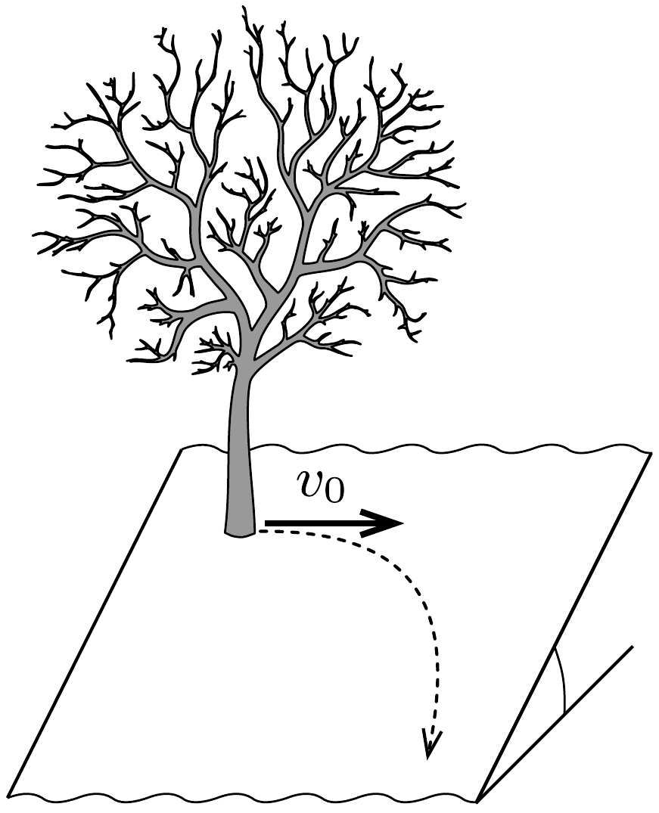

# Furfangos Szeminárium 4. Óra 

1. Egy fiú $v=5 \mathrm{~m} / \mathrm{s}$ sebességgel fut észak felé egy befagyott nagy tó sima jegén. A cipőtalpa és a jég között a csúszási és a tapadási súrlódási együttható megegyezik, értéke $\mu=0,1$. Az egyszerúség kedvéért tegyük fel, hogy a fiú által a jégre kifejtett függőleges irányú, időben változó nyomóerő helyettesíthető az átlagértékével.
a) Legalább mennyi időre van szüksége a fiúnak ahhoz, hogy eredetileg észak felé mutató sebességét keleti irányú, de szintén $v$ nagyságúra változtassa?
b) A lehetséges legrövidebb idő esetén milyen alakú pályán mozog a fiú a kanyarodás során?

 

2. Nagy kiterjedésú, síknak tekinthető lejtős domboldalon áll két fiú. A talaj annyira jeges, hogy már a legkisebb lendületvétel után egyenletes sebességgel csúsznának lefelé.

    Az egyikük (egy fához kapaszkodva) tréfából $v_{0}=1 \mathrm{~m} / \mathrm{s}$ vízszintes kezdősebességgel meglöki a társát, aki változó nagyságú és változó irányú sebességgel lecsúszik a lejtőn. Mekkora lesz a végsebessége, ha a légellenállás elhanyagolható, és a súrlódás független a sebességtől?
    

 
 
	Jó gondolkodást!

 
Csongi 
2026. oktober 14.

